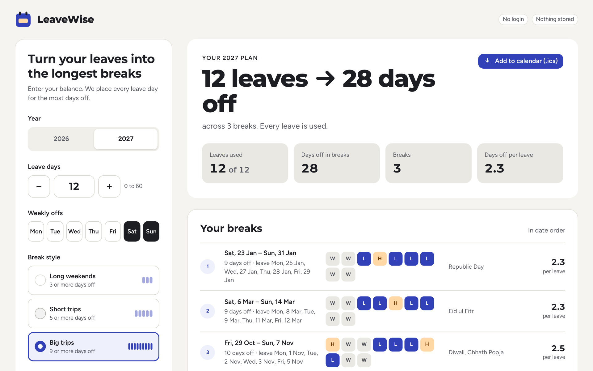
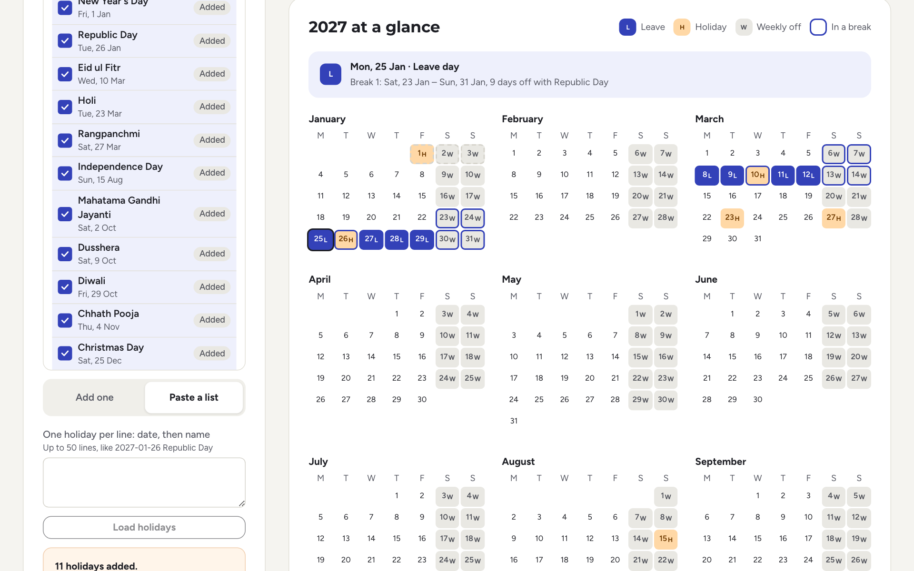
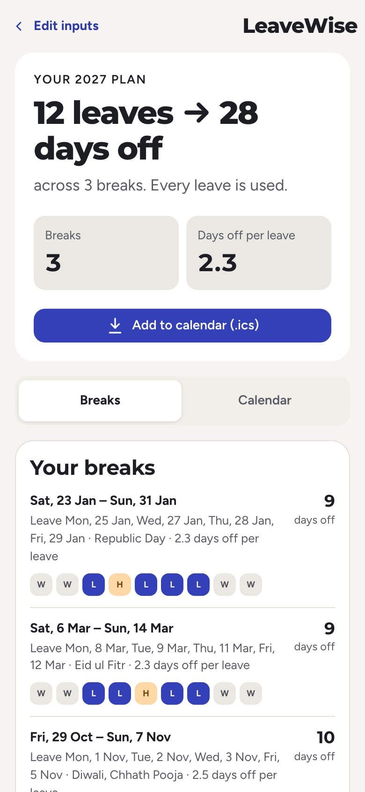

# LeaveWise

Enter your leave balance, holiday list, weekly offs and break style. LeaveWise returns the plan that gives you the
most days off inside breaks, and the tests prove it against a brute-force solver. It also shows a 12-month calendar
and gives you an `.ics` file for your calendar app. One page, no login, nothing stored.

**Demo video (4:43):** [on Google Drive](https://drive.google.com/file/d/1B_lObLL0Qkde35j6B8jt_MahFo5-QZZn/view?usp=sharing), with a product and a code walkthrough. The narration is a
synthetic voice; Claude Code scripted and recorded it ([scripts/demo-video/](scripts/demo-video/)).

**Live demo:** _link added after deployment (see [docs/DEPLOYMENT.md](docs/DEPLOYMENT.md))_

Built for the FiftyFive Build With AI Hackathon 2026 by Shekhar Aggarwal, with Claude Code doing the building under
the rules in [CLAUDE.md](CLAUDE.md). The requirements are in [docs/PRD.md](docs/PRD.md).



<p>
  
  
</p>

_2027, 12 leaves, Big trips, with FiftyFive's fixed holidays pasted in on their 2027 dates (the list and its sources
are in [docs/DEMO_SCRIPT.md](docs/DEMO_SCRIPT.md#2027-holiday-dates))._

## The problem

Each year, salaried employees in India sit with a calendar and the new holiday list, trying to work out which leave
days join holidays and weekends into long breaks. Holidays move every year, so last year's plan doesn't carry over.
With a limited balance, order matters: leaves spent on a weak break can leave too few for a strong one later.
Calendar apps show holidays but never say where to put your leaves.

## The solution

1. Pick the year and enter your leave days (default 12).
2. Check the holiday list: untick holidays that don't apply, add your company's own, or paste a list.
3. Set your weekly offs and break style: Long weekends (3+ days), Short trips (5+) or Big trips (9+).
4. Tap **Plan my leaves**. You get a summary in the PRD's form ("12 leaves → 41 days off across 9 breaks"), the list of breaks,
   a colour-and-letter calendar for the whole year, and a calendar file.

**How the plan is found.** A break is a run of days off, at least as long as the break style, with at least one
leave day in it. In the best plan, every break is a whole run of days off that starts and ends next to a working day
you don't take. So the planner lists those candidate runs and their cost in leaves. A dynamic program over the year
then picks the set of non-overlapping runs with the most days off within your balance. It is exact, not greedy,
and a full year with 60 leaves plans in milliseconds. When two plans tie, fewer leaves wins, then the plan whose
leave dates come first, so the same inputs always give the same plan. Details:
[ADR 0003](docs/adr/0003-optimisation-algorithm.md) and [ADR 0004](docs/adr/0004-deterministic-tie-breaks.md).

**How we know it's right.** A brute-force solver tries every combination of leave days on small random calendars,
and a property test checks that the planner matches it every time: 1,500 tries, all equal. Mutation testing (PIT)
kills 183 of 187 planner mutants (98%); the four survivors are explained in
[docs/ai/PROGRESS.md](docs/ai/PROGRESS.md). See [docs/QA.md](docs/QA.md) for every PRD rule and the test that
covers it.

## Quick start

You need Java 21 and Node 22, or just Docker.

```sh
# Docker: one image serves the page and the API
docker compose up                             # builds the image each time; stop with: docker compose down
# or: docker build -t leavewise . && docker run --rm -p 8080:8080 leavewise
# open http://localhost:8080

# Or run the two halves for development
cd backend && ./mvnw spring-boot:run          # API on port 8080
cd frontend && npm ci && npm run dev          # page on Vite's port, proxies /api to 8080

# Every check: tests, mutation testing, lint, build, a real-browser check, secret scan
scripts/quality-gate.sh
```

## Architecture

```
React page (Astryx, LeaveWise theme on Stone)   ──/api──>  Spring Boot 4.1 (Java 21)
                                                             ├─ planner   pure Java: day types, exact DP, results
                                                             ├─ holidays  one bundled JSON file per year, paste parser
                                                             ├─ ics       RFC 5545 writer
                                                             ├─ api       REST, validation, problem+json errors
                                                             └─ web       CSP and headers, rate limit, size limit
```

- One deployable: the page is built into the Spring Boot jar, and one Docker image runs both
  ([ADR 0001](docs/adr/0001-single-deployable.md)).
- No database, no login and no cookies: inputs come in, a plan goes out, and nothing is kept or logged
  ([ADR 0002](docs/adr/0002-no-database.md)).
- Security: server-side validation of every input, a request size limit, a per-IP rate limit, a strict Content
  Security Policy (no inline styles or scripts, checked at build time and in a real browser), and RFC 9457 error
  responses.
- Full details: [docs/ARCHITECTURE.md](docs/ARCHITECTURE.md) and the API contract in [docs/API.md](docs/API.md).

## For judges

| Criterion (weight) | Where to look |
| --- | --- |
| **AI practice (35%)** | [docs/ai/AI_WORKFLOW.md](docs/ai/AI_WORKFLOW.md): what the AI did and what the owner did at each stage, and every subagent run with its findings. [docs/ai/AI_FAILURE_LOG.md](docs/ai/AI_FAILURE_LOG.md): 21 AI mistakes, how each was caught (tests, the oracle, reviewers, CI), the fix, and the rule added to [CLAUDE.md](CLAUDE.md) so it doesn't repeat. Context engineering: [CLAUDE.md](CLAUDE.md), [frontend/CLAUDE.md](frontend/CLAUDE.md), subagents in [.claude/agents/](.claude/agents/), skills in [.claude/skills/](.claude/skills/), hooks in [.claude/settings.json](.claude/settings.json). The owner's brief and review notes, word for word: [docs/ai/kickoff-prompt.md](docs/ai/kickoff-prompt.md), [docs/ai/REVIEW_LOG.md](docs/ai/REVIEW_LOG.md). Every cloud commit carries a `Claude-Session` trailer linking it to the session that made it (`git log`). |
| **Engineering (30%)** | The exact planner and its proof: [ADR 0003](docs/adr/0003-optimisation-algorithm.md), [ADR 0005](docs/adr/0005-brute-force-oracle-testing.md), `backend/src/main/java/dev/leavewise/planner/`, `PlannerOracleProperties`. Tests: 318 backend, 115 frontend, PIT 183 of 187 mutants killed (98%). [scripts/quality-gate.sh](scripts/quality-gate.sh) runs 12 checks, including the real-browser check [frontend/scripts/browser-check.mjs](frontend/scripts/browser-check.mjs). CI: [.github/workflows/ci.yml](.github/workflows/ci.yml) (gate, dependency scan, Docker build). Decisions: [docs/adr/](docs/adr/). Delivery: [Dockerfile](Dockerfile), [render.yaml](render.yaml), [docs/DEPLOYMENT.md](docs/DEPLOYMENT.md). |
| **Product (25%)** | The PRD: [docs/PRD.md](docs/PRD.md). The PRD-rule-to-test map: [docs/QA.md](docs/QA.md). Error messages word for word from the PRD: [docs/API.md](docs/API.md). Phone first (360 px), keyboard use, colour never the only signal, WCAG 2.2 AA checked with axe in Chromium. Interpretations made and raised with the owner: [docs/ai/PROGRESS.md](docs/ai/PROGRESS.md). |
| **Idea (10%)** | The problem above: a yearly chore that calendar apps don't solve, answered with a provably best plan in under a minute. |

## Limitations

- **Holiday data:** 2026 comes prefilled with FiftyFive Technologies' own list (24 holidays, the 13 floaters
  unticked), with its source in the file ([ADR 0007](docs/adr/0007-holiday-data-source.md) and its amendment). No
  list is bundled for 2027 yet, so users add or paste their company's holidays. The app always reminds users to
  check their company's official list.
- **Ties favour early dates:** among equally good plans, the one with the earliest leave dates wins (the PRD's
  rule), so breaks can cluster early in the year.
- **Out of scope for the MVP** (PRD): half days and leave types, alternate-Saturday patterns (workaround: add those
  Saturdays as holidays), state-wise lists (add them as custom holidays), team views, other countries.
- **Nice-to-have results not built yet:** other good breaks, share link, and free long weekends outside the
  0-leave case. Their planned API shape is in [docs/API.md](docs/API.md).
- **Hosting:** on a free instance the app sleeps when idle, so the first request after a pause is slow.

## Dependencies

Versions are pinned. Licences were read from each package's `package.json` or Maven POM.

| Part | Dependency | Licence |
| --- | --- | --- |
| Backend | Spring Boot 4.1.1 (Spring MVC, Actuator, Validation), Tomcat 11.0.26, Jackson 3.1.7 | Apache-2.0 |
| Backend tests | JUnit Jupiter 6.0.3, jqwik 1.10.1 | EPL-2.0 |
| Backend tests | PIT 1.30.0; Spotless 3.10.4 (formatting) | Apache-2.0 |
| Frontend | React 19.3.0, Astryx 0.6.6 (`@astryxdesign/core`, `theme-stone`), StyleX 0.19.1 | MIT |
| Frontend | Figtree and Montserrat fonts (`@fontsource` 5.3.0), self-hosted | OFL-1.1 |
| Frontend build | Vite 8.3.4, ESLint, Prettier, Vitest, Testing Library, jsdom | MIT |
| Frontend build | TypeScript 6.0.3, Playwright 1.56.1 | Apache-2.0 |
| Frontend tests | axe-core 4.14.0 | MPL-2.0 |

Astryx is a beta design system; why it was chosen and how the risk is handled are in
[ADR 0008](docs/adr/0008-astryx-design-system.md).
