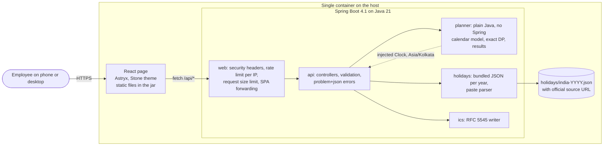
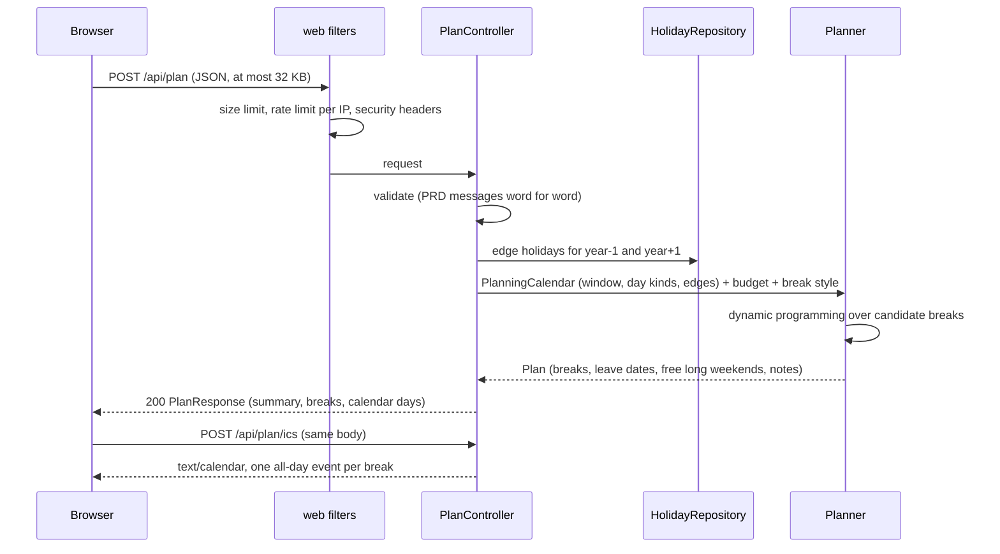

# Architecture

LeaveWise is one Spring Boot process that serves both the React page and a small JSON API. Nothing is stored:
every request carries all its inputs, and the only data on disk are the bundled holiday lists.

## Context and containers



## Request flow: "Plan my leaves"



## Modules

| Package | Responsibility | Depends on |
| --- | --- | --- |
| `dev.leavewise.planner` | Builds the planning calendar (window, day kinds, year edges), finds the best plan, derives breaks, free long weekends and notes. Pure Java, no I/O, no Spring. | `java.time` only |
| `dev.leavewise.holidays` | Loads and checks `holidays/india-YYYY.json` resources at startup; parses pasted `YYYY-MM-DD Name` lines with per-line errors; merges duplicates. | planner model |
| `dev.leavewise.ics` | Writes RFC 5545 calendars: CRLF line endings, line folding, text escaping, `VALUE=DATE` all-day events. | planner model |
| `dev.leavewise.api` | HTTP contract in `docs/API.md`: records, validation, mapping, `ProblemDetail` errors. | all of the above |
| `dev.leavewise.web` | Servlet filters for security headers, per-IP rate limiting and body size; forwards non-API paths to `index.html`. | Spring Web |

The planner never sees HTTP types, and the API layer never makes planning decisions. That boundary lets the planner
be tested exhaustively (unit, property and brute-force oracle tests, PIT mutation testing) without Spring.

## Planner design in one paragraph

The planner turns the inputs into a sequence of days, each either a working day (a leave can go there) or a day off
(weekly off or holiday). The sequence covers the planning window (1 January, or tomorrow for the current year, to
31 December) plus the run of days off just before 1 January and just after 31 December. In the best plan every
break is a maximal run of days off bounded by untaken working days, so the planner enumerates those candidate runs
and chooses a non-overlapping set with dynamic programming over (position, leaves left). The order of comparison is
total days in breaks, then fewer leaves, then the earliest leave dates. See ADR 0003 to 0006.

## Frontend

```
frontend/src/
  api/         typed client and types that mirror docs/API.md
  features/    planner form, results (summary, break list, year calendar, .ics download)
  lib/         date formatting (Indian format), small pure helpers
  test/        test setup, axe helper
```

The page is scaffolded from an Astryx template; layout, spacing and colour come from Astryx components and Stone
tokens only (ADR 0008). The calendar marks weekly offs, holidays, leave days and breaks with colour **and** a text
label. The browser checks inputs for fast feedback; the server checks them again and is the authority.

## Cross-cutting concerns

| Concern | Decision |
| --- | --- |
| Time | One `Clock` bean in Asia/Kolkata. "Today", the default year and "plan from tomorrow" all use it. Tests inject a fixed clock. |
| Determinism | Inputs are normalised (holidays sorted and merged, weekly offs as a set) before planning; ties have a total order (ADR 0004). |
| Privacy | No database, cookies, analytics or request logging. Error responses never echo input values into logs. |
| Security | Server-side validation, 32 KB body limit, per-IP token bucket on `/api/**`, CSP and other headers (see `docs/API.md`). |
| Performance | The planner is O(days × leaves × candidate ends); a full year with 60 leave days must plan in under 1 s (tested). |
| Deployment | Multi-stage Dockerfile: Node builds the page, Maven builds the jar with the page inside, a JRE image runs it. |

## Trade-offs

- **One process, no database** (ADR 0001, 0002): the simplest thing that meets the PRD. The cost is no saved plans,
  which the PRD rules out of scope anyway.
- **Exact DP instead of a heuristic** (ADR 0003): a little more code than greedy, but the plan is provably optimal and
  checked against a brute-force oracle on 1,000+ random calendars (ADR 0005).
- **Server computes the calendar days** rather than the browser re-deriving them: one source of truth for day
  classification, at the cost of about 20 KB more JSON per plan.
- **Paste parsing on the server** (`POST /api/holidays/parse`): one tested parser and one set of messages, at the
  cost of one extra request when the user pastes a list.
- **Astryx beta** (ADR 0008): a design system with strong rules and agent docs, at the cost of beta risk, handled by
  exact version pins.
